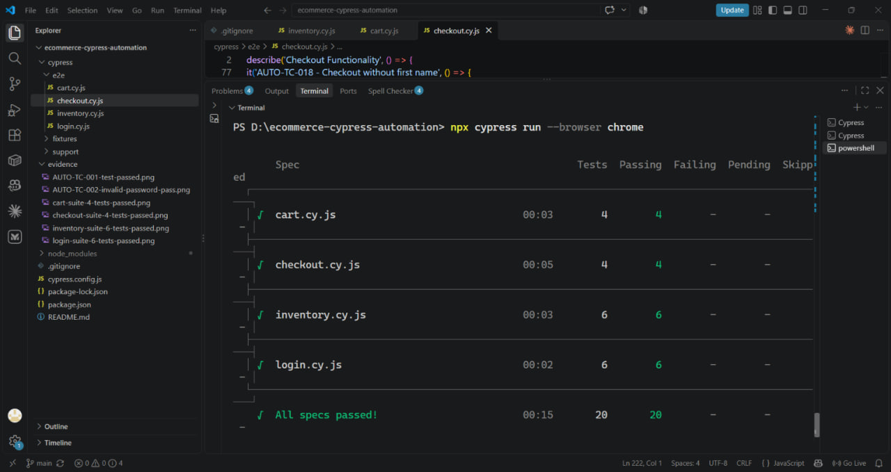
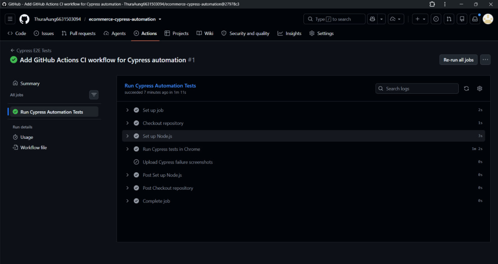

# E-Commerce Web Automation Testing with Cypress

**End-to-End Functional Testing | JavaScript | Cypress | GitHub Actions**

An automated testing project designed to validate essential features of the Swag Labs (SauceDemo) e-commerce web application using Cypress and JavaScript.

The project demonstrates practical QA automation skills through automated functional testing, positive and negative test scenarios, regression testing, reusable commands, external test data management, and CI/CD integration.

## 1. Project Overview

This project focuses on designing, implementing, and executing automated end-to-end tests for an e-commerce web application.

The application under test is [Swag Labs (SauceDemo)](https://www.saucedemo.com/), a demonstration shopping website commonly used for practicing software testing.

A total of **20 automated test cases** were implemented across four major functional modules:

- User Login and Authentication
- Product Inventory
- Shopping Cart
- Checkout Process

The automation suite uses Cypress and JavaScript to simulate user interactions, validate expected application behavior, and support repeatable regression testing.

The project also includes test documentation, reusable Cypress commands, JSON fixtures, execution evidence, and a GitHub Actions CI workflow.

## 2. Project Objectives

The main objectives are to:

- Automate critical e-commerce user workflows.
- Validate successful and unsuccessful login scenarios.
- Verify product information and sorting functionality.
- Test shopping cart operations.
- Automate the complete checkout process.
- Validate required-field error messages.
- Implement reusable Cypress commands.
- Separate test data from automation scripts.
- Execute the complete automation suite.
- Integrate automated testing into GitHub Actions.
- Document test cases, execution results, and evidence.

## 3. Technology Stack

| Technology | Purpose |
|---|---|
| Cypress | End-to-end test automation |
| JavaScript | Test scripting |
| Node.js | JavaScript runtime |
| npm | Dependency management |
| Google Chrome | Browser execution |
| Visual Studio Code | Development environment |
| Git | Version control |
| GitHub | Repository hosting |
| GitHub Actions | Continuous integration |
| JSON | Test data fixtures |
| Markdown | QA documentation |

## 4. Application Under Test

**Application:** Swag Labs / SauceDemo

**Website:** https://www.saucedemo.com/

The application provides demonstration features including:

- User authentication
- Product browsing
- Product sorting
- Shopping cart management
- Checkout information validation
- Order confirmation

All automated tests use demonstration accounts and simulated transactions. No real purchases or payment processing are performed.

## 5. Automated Test Coverage

The automation suite contains 20 test cases organized into four Cypress specification files.

| Module | Test IDs | Total |
|---|---|---:|
| Login Automation | AUTO-TC-001–006 | 6 |
| Product Inventory | AUTO-TC-007–012 | 6 |
| Shopping Cart | AUTO-TC-013–016 | 4 |
| Checkout | AUTO-TC-017–020 | 4 |
| **Total** | | **20** |

### Module 1 — Login Automation

**File:** `cypress/e2e/login.cy.js`

| Test ID | Test Scenario |
|---|---|
| AUTO-TC-001 | Login with valid credentials |
| AUTO-TC-002 | Login with incorrect password |
| AUTO-TC-003 | Login with empty username |
| AUTO-TC-004 | Login with empty password |
| AUTO-TC-005 | Login with both fields empty |
| AUTO-TC-006 | Login with locked-out user |

**Coverage:** Positive login, negative login, error-message validation, and account restrictions.

### Module 2 — Product Inventory

**File:** `cypress/e2e/inventory.cy.js`

| Test ID | Test Scenario |
|---|---|
| AUTO-TC-007 | Verify inventory page loads successfully |
| AUTO-TC-008 | Verify product names |
| AUTO-TC-009 | Verify product prices |
| AUTO-TC-010 | Sort products by price low to high |
| AUTO-TC-011 | Sort products by price high to low |
| AUTO-TC-012 | Verify product details page |

**Coverage:** Inventory display, product data validation, sorting functionality, and navigation.

### Module 3 — Shopping Cart

**File:** `cypress/e2e/cart.cy.js`

| Test ID | Test Scenario |
|---|---|
| AUTO-TC-013 | Add one product to cart |
| AUTO-TC-014 | Add multiple products to cart |
| AUTO-TC-015 | Remove product from cart |
| AUTO-TC-016 | Verify product details in shopping cart |

**Coverage:** Cart operations, item quantities, product information, and cart badge validation.

### Module 4 — Checkout Automation

**File:** `cypress/e2e/checkout.cy.js`

| Test ID | Test Scenario |
|---|---|
| AUTO-TC-017 | Complete successful checkout |
| AUTO-TC-018 | Checkout without first name |
| AUTO-TC-019 | Checkout without last name |
| AUTO-TC-020 | Checkout without postal code |

**Coverage:** End-to-end checkout, order confirmation, required-field validation, and error handling.

## 6. Test Execution Results

The complete regression suite was executed locally using Cypress and Google Chrome.

### Local Regression Summary

| Metric | Result |
|---|---:|
| Total Test Cases | 20 |
| Executed | 20 |
| Passed | 20 |
| Failed | 0 |
| Pass Rate | 100% |
| Recorded Execution Time | Approximately 15 seconds |

**Result: All Specs Passed**

These results represent the verified local regression execution, not a guarantee that the application is defect-free.

### Full Regression Evidence



## 7. Installation and Setup

### Prerequisites

Install the following software:

- [Node.js](https://nodejs.org/)
- [Git](https://git-scm.com/)
- [Google Chrome](https://www.google.com/chrome/)
- [Visual Studio Code](https://code.visualstudio.com/) (recommended)

### Clone the Repository

```powershell
git clone https://github.com/ThuraAung6631503094/ecommerce-cypress-automation.git

cd ecommerce-cypress-automation
```

### Install Dependencies

```powershell
npm ci
```

This installs the project dependencies according to `package-lock.json`.

### Open Cypress

```powershell
npx cypress open
```

Select E2E Testing, choose Chrome, and open the desired test specification.

### Run All Automated Tests

```powershell
npx cypress run --browser chrome
```

### Run Individual Test Modules

**Login Tests**

```powershell
npx cypress run --spec "cypress/e2e/login.cy.js" --browser chrome
```

**Inventory Tests**

```powershell
npx cypress run --spec "cypress/e2e/inventory.cy.js" --browser chrome
```

**Shopping Cart Tests**

```powershell
npx cypress run --spec "cypress/e2e/cart.cy.js" --browser chrome
```

**Checkout Tests**

```powershell
npx cypress run --spec "cypress/e2e/checkout.cy.js" --browser chrome
```

## 8. Project Structure

```text
ecommerce-cypress-automation/
|
|-- .github/
|   |-- workflows/
|       |-- cypress.yml
|
|-- cypress/
|   |-- e2e/
|   |   |-- login.cy.js
|   |   |-- inventory.cy.js
|   |   |-- cart.cy.js
|   |   |-- checkout.cy.js
|   |
|   |-- fixtures/
|   |   |-- users.json
|   |   |-- checkout-data.json
|   |
|   |-- support/
|       |-- commands.js
|       |-- e2e.js
|
|-- docs/
|   |-- automation-test-plan.md
|   |-- test-cases.md
|   |-- execution-summary.md
|
|-- evidence/
|   |-- AUTO-TC-001-test-passed.png
|   |-- AUTO-TC-002-invalid-password-pass.png
|   |-- login-suite-6-tests-passed.png
|   |-- inventory-suite-6-tests-passed.png
|   |-- cart-suite-4-tests-passed.png
|   |-- checkout-suite-4-tests-passed.png
|   |-- full-regression-20-tests-passed.png
|   |-- github-actions-ci-passed.png
|
|-- .gitignore
|-- cypress.config.js
|-- package.json
|-- package-lock.json
|-- README.md
```

## 9. Reusable Cypress Commands

To improve code maintainability, a reusable login command was implemented in:

`cypress/support/commands.js`

Instead of repeating the same login operations, tests can use:

```javascript
cy.login()
```

The command reads default valid user credentials from the fixture and verifies successful authentication.

This approach reduces duplicated code and centralizes the login procedure.

## 10. Test Data Management

External JSON fixtures are used to organize demonstration test data.

**User Credentials:** `cypress/fixtures/users.json`

**Checkout Information:** `cypress/fixtures/checkout-data.json`

Example of loading test data:

```javascript
cy.fixture('checkout-data').then((data) => {
  cy.get('[data-test="firstName"]')
    .type(data.validCustomer.firstName)
})
```

Using fixtures separates test data from the main automation logic and makes test maintenance easier.

## 11. GitHub Actions CI/CD

The project includes a GitHub Actions workflow for automated Cypress test execution.

**Workflow file:** `.github/workflows/cypress.yml`

The workflow runs when code is pushed to the `main` branch or a pull request targets `main`.

The pipeline performs the following activities:

1. Checks out repository code.
2. Configures Node.js.
3. Installs project dependencies.
4. Executes Cypress tests in Chrome.
5. Reports successful or failed execution.
6. Uploads failure screenshots when available.

A successful GitHub Actions workflow run has been recorded.

### CI/CD Evidence



## 12. Test Evidence

Screenshots are stored in the `evidence/` directory to support test execution reporting.

| Evidence | Description |
|---|---|
| [Login Suite](evidence/login-suite-6-tests-passed.png) | Six login tests passing |
| [Inventory Suite](evidence/inventory-suite-6-tests-passed.png) | Six inventory tests passing |
| [Shopping Cart Suite](evidence/cart-suite-4-tests-passed.png) | Four shopping cart tests passing |
| [Checkout Suite](evidence/checkout-suite-4-tests-passed.png) | Four checkout tests passing |
| [Full Regression](evidence/full-regression-20-tests-passed.png) | All 20 automated tests passing |
| [GitHub Actions](evidence/github-actions-ci-passed.png) | Successful CI workflow |

## 13. QA Documentation

Additional documentation is available in the `docs/` folder.

- [Automation Test Plan](docs/automation-test-plan.md) — Test objectives, scope, testing approach, environment, and exit criteria.
- [Automated Test Cases](docs/test-cases.md) — Detailed descriptions of the 20 automated test scenarios.
- [Test Execution Summary](docs/execution-summary.md) — Execution results, regression statistics, and evidence references.

## 14. Testing Techniques Applied

This project demonstrates:

- Functional Testing
- End-to-End Testing
- Positive Testing
- Negative Testing
- Regression Testing
- UI Validation
- Form Validation
- Automated Assertions
- Data-Driven Testing Basics
- Reusable Test Commands
- Continuous Integration

## 15. Project Limitations

The current automation scope is limited to selected functional workflows.

The project does not currently include automated performance testing, security testing, API testing, accessibility testing, mobile application testing, or comprehensive cross-browser testing.

The test scripts depend on the availability and expected behavior of the public SauceDemo application.

Changes to the application or test environment may require updates to the automation suite.

## 16. Future Improvements

Potential improvements include:

- Extending cross-browser execution to Firefox and Edge.
- Adding API testing coverage.
- Implementing more data-driven test scenarios.
- Adding HTML test reports.
- Expanding negative test coverage.
- Improving test data and fixture management.
- Adding more advanced CI reporting.

## 17. Skills Demonstrated

Through this project, the following practical skills were applied:

**QA Testing:** Test case design, functional validation, positive and negative testing, regression execution, and test reporting.

**Automation:** Cypress, JavaScript, selectors, assertions, custom commands, and external test data.

**Development Tools:** VS Code, Node.js, npm, Git, and GitHub.

**CI/CD:** GitHub Actions workflow configuration and automated browser test execution.

**Documentation:** Test planning, test case documentation, evidence collection, and execution summaries.

## 18. Conclusion

The E-Commerce Web Automation Testing project demonstrates the implementation of a structured Cypress automation framework for the SauceDemo application.

The project includes 20 functional automated test cases, a verified passing local regression suite, reusable Cypress commands, JSON test fixtures, test documentation, and a successful GitHub Actions CI workflow.

It serves as a practical demonstration of foundational QA automation and software testing skills.

---

**Project Type:** Personal QA Automation Portfolio Project  
**Repository:** [ecommerce-cypress-automation](https://github.com/ThuraAung6631503094/ecommerce-cypress-automation)